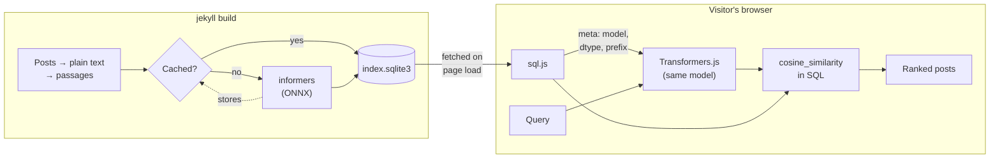
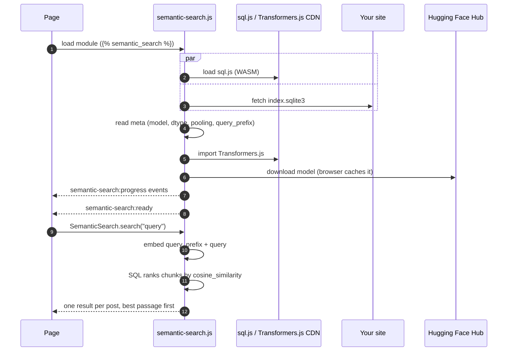
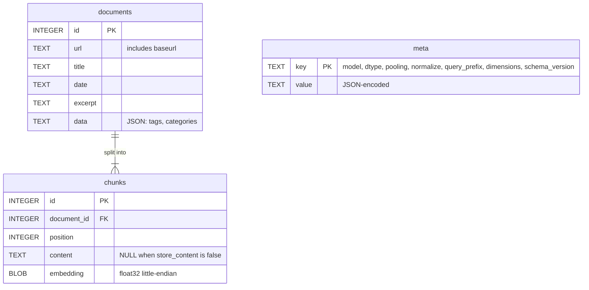

# jekyll-semantic-search

Semantic search for Jekyll sites that runs entirely in the visitor's browser.

When your site is built, the plugin splits each post into passages, embeds
them with an ONNX model of your choice and stores the vectors in a SQLite
database. On page load the browser downloads that database (via
[sql.js](https://github.com/sql-js/sql.js)) and the same model (via
[Transformers.js](https://huggingface.co/docs/transformers.js)). Search queries
are embedded and ranked locally with SQL. No search server or API keys needed.



## Installation

Add the gem to your site's `Gemfile`:

```ruby
group :jekyll_plugins do
  gem "jekyll-semantic-search"
end
```

Run `bundle install`, then add the tag to the `<head>` of any layout that
needs search:

```liquid

```

The tag emits a small JSON config and loads the runtime as an ES module. The
module downloads the index when the page loads and defines
`window.SemanticSearch`.

## Searching from JavaScript

```js
await SemanticSearch.ready; // index downloaded and (by default) model loaded

const results = await SemanticSearch.search("how do I make bread rise?", {
  limit: 5,       // default 10
  minScore: 0.2,  // cosine similarity threshold, default -1 (no filter)
});
// [{ id, url, title, date, excerpt, data: { tags, categories }, passage, score }, …]
```

Each post appears at most once, scored by its best-matching passage, and
`passage` holds that passage's text. Events are dispatched on `document`:

| Event                      | `detail`                                                  |
| -------------------------- | --------------------------------------------------------- |
| `semantic-search:ready`    | `{ meta }`: the embedding settings read from the index    |
| `semantic-search:progress` | Transformers.js download progress (`status`, `progress`, …) |
| `semantic-search:error`    | `{ error }`                                               |

What happens on a page that includes the tag:



With `preload_model: false`, steps 5–7 run on the first search instead of on
page load.

See [`example/index.html`](example/index.html) for a complete search box.

Without the Liquid tag, import the module yourself and start it explicitly:

```js
import { SemanticSearch } from "/assets/semantic-search/semantic-search.js";
await SemanticSearch.start({
  databaseUrl: "/assets/semantic-search/index.sqlite3",
  sqlJsUrl: "https://cdn.jsdelivr.net/npm/sql.js@1.14.2/dist/",
  transformersUrl: "https://cdn.jsdelivr.net/npm/@huggingface/transformers@4.3.1",
});
```

## Configuration

Everything is optional. Defaults shown:

```yaml
semantic_search:
  enabled: true

  # Any Transformers.js-compatible feature-extraction model on the Hugging Face
  # Hub (one with an onnx/ folder, e.g. the Xenova/* conversions).
  model: Xenova/all-MiniLM-L6-v2
  dtype: q8              # fp32 | fp16 | q8 | int8 | uint8 | q4 | q4f16 | bnb4
  pooling: mean          # mean | cls
  normalize: true

  # Some models expect instruction prefixes, e.g. e5 ("passage: " / "query: ")
  # or bge ("" / "Represent this sentence for searching relevant passages: ").
  document_prefix: ""
  query_prefix: ""

  collections: [posts]   # any collections whose documents should be indexed
  chunk_size: 150        # words per passage; keep within the model's context
  chunk_overlap: 30      # words shared between consecutive passages
  batch_size: 16
  store_content: true    # store passage text (enables `passage` in results)
  cache: true            # reuse embeddings between builds

  output_dir: assets/semantic-search
  database: index.sqlite3

  # Browser runtime
  transformers_url: https://cdn.jsdelivr.net/npm/@huggingface/transformers@4.3.1
  sql_js_url: https://cdn.jsdelivr.net/npm/sql.js@1.14.2/dist/
  preload_model: true    # false: download the model on the first search
```

To leave a single document out of the index, set this in its front matter:

```yaml
semantic_search: false
```

### Choosing a model

The model, dtype, pooling, normalisation and query prefix are written into
the database's `meta` table. The browser reads them from there, so the query
is always embedded the same way the posts were. Changing any of them
re-embeds everything on the next build.

Build-time embedding uses [informers](https://github.com/ankane/informers),
a Ruby port of Transformers.js running on ONNX Runtime. With `dtype: fp32`
the browser and build vectors are identical (cosine similarity 1.0 in our
checks). Quantized dtypes such as the default `q8` differ very slightly
(≈0.99) because ONNX Runtime builds implement quantized kernels a little
differently. That does not change rankings in practice, and visitors download
a model about four times smaller (≈23 MB instead of ≈90 MB for MiniLM).
Browsers cache the model after the first visit.

Examples that work well:

| Model                      | dims | Notes                                                         |
| -------------------------- | ---- | ------------------------------------------------------------- |
| `Xenova/all-MiniLM-L6-v2`  | 384  | Default. Small and fast, English                              |
| `Xenova/bge-small-en-v1.5` | 384  | `pooling: cls`; optional query prefix                      |

### Build cache

Embeddings are cached in `.jekyll-cache/jekyll-semantic-search/embeddings.sqlite3`,
keyed by the embedding settings and the exact passage text. `jekyll serve`
only embeds passages that changed. Delete the file to start fresh.

## Database schema



Embeddings are little-endian float32 blobs, the same layout
[sqlite-vec](https://github.com/asg017/sqlite-vec) uses. The browser runtime
registers a `cosine_similarity(a, b)` SQL function, so you can write your own
queries against the database.

## Development

```sh
bundle install
bundle exec rake test     # Ruby tests (no model download; uses a hashing embedder)
npm install
npm test                  # browser-runtime tests on Node 20+, incl. an end-to-end
                          # search over an index built by the Ruby side
```

To try it with a real model:

```sh
cd example
bundle install
bundle exec jekyll serve
```

Layout:

```
lib/jekyll/semantic_search/
  configuration.rb      settings and validation
  text_extractor.rb     rendered HTML → plain text
  chunker.rb            overlapping word windows
  informers_embedder.rb build-time model (informers / ONNX Runtime)
  embedding_cache.rb    batching + persistent embedding cache
  index_writer.rb       SQLite index
  indexer.rb            site documents → entries
  static_files.rb       runtime assets and the index as Jekyll static files
  generator.rb          registers files; pluggable embedder factory
  tag.rb                
assets/semantic-search/
  search-core.js        sql.js search logic (environment-independent)
  semantic-search.js    browser entry point
```

Custom build-time embedders can be plugged in from a site plugin. The object
must respond to `embed(texts)` and return one vector per text. Its vectors
must match what the browser model produces:

```ruby
Jekyll::SemanticSearch.embedder_factory = ->(config) { MyEmbedder.new(config.model) }
```

## License

MIT
