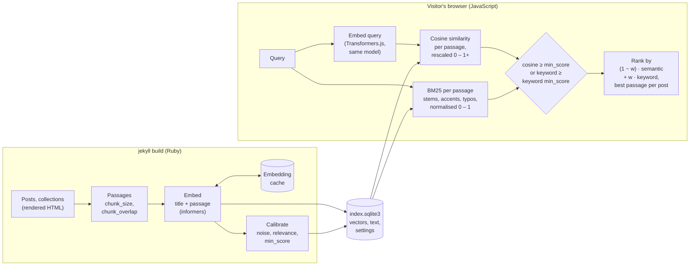
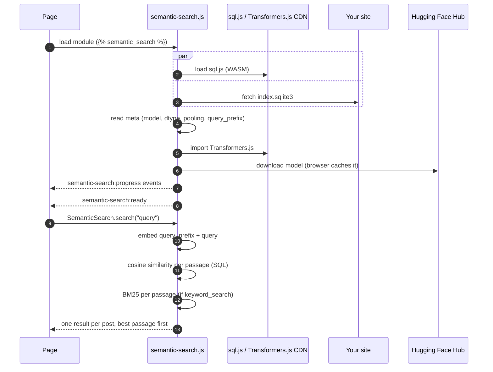
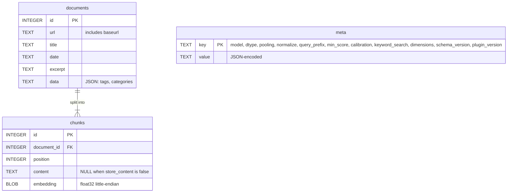

# jekyll-semantic-search

[](https://github.com/mourjo/jekyll-semantic-search/actions/workflows/test.yml)

Semantic search for Jekyll sites that runs entirely in the visitor's browser,
with optional BM25 keyword search to catch the exact and near word matches
embeddings miss.

When your site is built, the plugin splits each post into passages, embeds
them with an ONNX model of your choice and stores the vectors in a SQLite
database. On page load the browser downloads that database (via
[sql.js](https://github.com/sql-js/sql.js)) and the same model (via
[Transformers.js](https://huggingface.co/docs/transformers.js)). Queries are
embedded and ranked locally. No search server or API keys needed.

## Architecture



At build time, Ruby turns every indexed document into passages and embeds
each one. It then measures two reference scores for the chosen model: how high
unrelated queries score (noise) and how high a post's title scores against the
post (relevance). Everything the browser needs goes into one SQLite file: the
vectors, the passage text, the model settings, those two levels and your search
settings.

In the browser, every search runs two scorers over every passage:

- **Semantic:** the cosine similarity between the query's embedding and the
  passage's. It finds posts about the same thing in different words.
- **Keyword** (when `keyword_search` is on): BM25 over the passage text. It
  finds posts that contain the query's words, including inflected forms
  ("tomato" → "tomatoes") and typos ("Lauterbrunen" → "Lauterbrunnen").

A passage is returned if either scorer is confident about it. Results are
ranked by a weighted mix of both scores, each normalised to a comparable 0–1
scale. Each post appears once, represented by its best passage. See
[Keyword search](#keyword-search) for the details.

## Installation

Add the gem to your site's `Gemfile`:

```ruby
group :jekyll_plugins do
  gem "jekyll-semantic-search"
end
```

Run `bundle install`, then add the tag to the `<head>` of any layout that
needs search:

```liquid

```

The tag emits a small JSON config and loads the runtime as an ES module. The
module downloads the index when the page loads and defines
`window.SemanticSearch`.

## Searching from JavaScript

```js
await SemanticSearch.ready; // index downloaded and (by default) model loaded

const results = await SemanticSearch.search("how do I make bread rise?", {
  limit: 5,                      // default 10
  minScore: 0.3,                 // default: min_score from _config.yml
  keyword: { weight: 0.5 },      // defaults: keyword_search from _config.yml
});
```

Every option is optional. Without one, the value from `_config.yml` (stored in
the index) applies:

| Option                  | Default                         | Meaning                                                                 |
| ----------------------- | ------------------------------- | ----------------------------------------------------------------------- |
| `limit`                 | `10`                            | Most posts to return                                                    |
| `minScore`              | `min_score`, or −1 if unset     | Cosine similarity a passage needs to be returned. −1 returns everything |
| `keyword.enabled`       | `keyword_search.enabled`        | Run keyword search for this query                                       |
| `keyword.weight`        | `keyword_search.weight`         | Share of the keyword score in the ranking                               |
| `keyword.minScore`      | `keyword_search.min_score`      | Keyword score at which a match counts                                   |
| `keyword.typoTolerance` | `keyword_search.typo_tolerance` | Match words one typo away                                               |

Each result is one post:

| Field                                   | Meaning                                                                                          |
| --------------------------------------- | ------------------------------------------------------------------------------------------------ |
| `id`, `url`, `title`, `date`, `excerpt` | The post. `url` includes the site's `baseurl`                                                    |
| `data`                                  | `{ tags, categories }` from the front matter                                                     |
| `passage`                               | Text of the post's best-matching passage (`null` with `store_content: false`)                    |
| `score`                                 | What results are sorted by: the cosine similarity, or with keyword search on, the combined score |
| `semantic`                              | Cosine similarity of the passage to the query                                                    |
| `keyword`                               | Normalised BM25 score of the passage, 0–1 (0 when keyword search is off)                         |
| `matches`                               | Query words, as typed, found in the passage, e.g. for highlighting                               |

Events are dispatched on `document`:

| Event                      | `detail`                                                    |
| -------------------------- | ----------------------------------------------------------- |
| `semantic-search:ready`    | `{ meta }`: the settings read from the index                |
| `semantic-search:progress` | Transformers.js download progress (`status`, `progress`, …) |
| `semantic-search:error`    | `{ error }`                                                 |

What happens on a page that includes the tag:



With `preload_model: false`, steps 5–7 run on the first search instead of on
page load.

See [`example/index.html`](example/index.html) for a complete search box.

Without the Liquid tag, import the module yourself and start it explicitly:

```js
import { SemanticSearch } from "/assets/semantic-search/semantic-search.js";
await SemanticSearch.start({
  databaseUrl: "/assets/semantic-search/index.sqlite3",
  sqlJsUrl: "https://cdn.jsdelivr.net/npm/sql.js@1.14.2/dist/",
  transformersUrl: "https://cdn.jsdelivr.net/npm/@huggingface/transformers@4.3.1",
});
```

## Configuration

Everything is optional. A typical setup only needs:

```yaml
semantic_search:
  min_score: auto        # drop results that are not about the query
  keyword_search: true   # also catch exact, inflected and misspelt words
```

All settings with their defaults:

```yaml
semantic_search:
  enabled: true

  # What to index
  collections: [posts]
  chunk_size: 150
  chunk_overlap: 30
  store_content: true

  # Embedding model
  model: Xenova/all-MiniLM-L6-v2
  dtype: q8
  pooling: mean
  normalize: true
  document_prefix: ""
  query_prefix: ""
  batch_size: 16
  cache: true

  # Relevance
  min_score:             # unset: no filter; a number in [-1, 1]; or auto
  keyword_search:        # true, false, or a mapping of these settings:
    enabled: false
    weight: 0.3
    min_score: 0.5
    stemming: true
    typo_tolerance: true
    k1: 1.2
    b: 0.75

  # Output and browser runtime
  output_dir: assets/semantic-search
  database: index.sqlite3
  transformers_url: https://cdn.jsdelivr.net/npm/@huggingface/transformers@4.3.1
  sql_js_url: https://cdn.jsdelivr.net/npm/sql.js@1.14.2/dist/
  preload_model: true
```

### What to index

| Setting         | Default   | Description |
| --------------- | --------- | ----------- |
| `enabled`       | `true`    | `false` turns the plugin off: no index is built and `` renders nothing. |
| `collections`   | `[posts]` | Collections whose documents are indexed, e.g. `[posts, docs]`. Pages outside collections are not indexed. Documents with `published: false` and collections that are not output are skipped. |
| `chunk_size`    | `150`     | Words per passage. Each passage is embedded and scored on its own, and a post is represented by its best passage, so a long post can match on any one section. Models only read a limited number of tokens (MiniLM: 256, about 190 words), so larger values cut text off. |
| `chunk_overlap` | `30`      | Words shared by consecutive passages, so a sentence split across a boundary still appears whole in one passage. Must be smaller than `chunk_size`. |
| `store_content` | `true`    | Store the passage text in the index. Needed for `passage` in results and for keyword search, which then only sees titles. `false` makes the index smaller and keeps the full text out of the downloadable file. |

To leave a single document out of the index, set this in its front matter:

```yaml
semantic_search: false
```

### Embedding model

| Setting           | Default                   | Description |
| ----------------- | ------------------------- | ----------- |
| `model`           | `Xenova/all-MiniLM-L6-v2` | Any Transformers.js-compatible feature-extraction model on the Hugging Face Hub (one with an `onnx/` folder). The same model embeds posts at build time and queries in the browser. See [Choosing a model](#choosing-a-model). |
| `dtype`           | `q8`                      | Weight precision: `fp32`, `fp16`, `q8`, `int8`, `uint8`, `q4`, `q4f16` or `bnb4`. Quantised types download faster (`q8` MiniLM: ≈23 MB instead of ≈90 MB) and rank the same in practice. |
| `pooling`         | `mean`                    | How token vectors become one vector: `mean` or `cls`. Use what the model card says (`cls` for bge, arctic and mxbai). |
| `normalize`       | `true`                    | Scale vectors to length 1. Leave on: every model listed below is trained for it. |
| `document_prefix` | `""`                      | Text put before every passage before embedding. Some models need one, e.g. `"passage: "` for e5. |
| `query_prefix`    | `""`                      | Text put before every query, e.g. `"query: "` for e5. Stored in the index so the browser applies it too. |
| `batch_size`      | `16`                      | Passages embedded per model call at build time. Affects build speed and memory only. |
| `cache`           | `true`                    | Reuse embeddings of unchanged passages between builds. See [Build cache](#build-cache). |

Changing `model`, `dtype`, `pooling` or `normalize` re-embeds everything on the
next build.

### Relevance

| Setting                         | Default | Description |
| ------------------------------- | ------- | ----------- |
| `min_score`                     | unset   | Cosine similarity a passage needs to be returned. Unset returns the closest posts whatever their score; `auto` picks a value for your model and site at build time. See [Filtering out irrelevant results](#filtering-out-irrelevant-results). |
| `keyword_search`                | `false` | `true` turns on [keyword search](#keyword-search) with the defaults below. A mapping turns it on and changes some of them (add `enabled: false` to keep it off). |
| `keyword_search.weight`         | `0.3`   | Share of the keyword score in the ranking, 0–1. |
| `keyword_search.min_score`      | `0.5`   | Keyword score, 0–1, at which a keyword match counts. |
| `keyword_search.stemming`       | `true`  | Reduce English words to their stem so inflected forms match. |
| `keyword_search.typo_tolerance` | `true`  | Let query words of 5 or more letters match words one typo away. |
| `keyword_search.k1`             | `1.2`   | BM25 term-frequency saturation. |
| `keyword_search.b`              | `0.75`  | BM25 length normalisation, 0–1. |

`keyword_search` settings are explained in [Keyword search settings](#keyword-search-settings).

### Output and browser runtime

| Setting            | Default                                                        | Description |
| ------------------ | -------------------------------------------------------------- | ----------- |
| `output_dir`       | `assets/semantic-search`                                       | Where in the built site the index and the runtime scripts go. |
| `database`         | `index.sqlite3`                                                | File name of the index. |
| `transformers_url` | `https://cdn.jsdelivr.net/npm/@huggingface/transformers@4.3.1` | Where the browser loads Transformers.js from. Point it at a self-hosted copy to avoid the CDN. |
| `sql_js_url`       | `https://cdn.jsdelivr.net/npm/sql.js@1.14.2/dist/`             | Folder the browser loads `sql-wasm.js` and `sql-wasm.wasm` from. |
| `preload_model`    | `true`                                                         | Download the model when the page loads. `false` waits for the first search, which saves visitors who never search the download but makes that search slower. |

### Filtering out irrelevant results

Without a threshold, every search returns the `limit` closest posts, even when
none of them is about the query. `min_score` sets the cosine similarity a post's
best passage must reach. It is stored in the index and used as the default
`minScore` in the browser; pass `minScore` to `search()` to override it, or
`minScore: -1` to see everything.

A good value depends on the model. Unrelated text scores about 0.1 with
`all-MiniLM-L6-v2`, but about 0.5 with `bge-small-en-v1.5` and 0.75 with
`gte-small`. Rather than picking a number, you can set:

```yaml
semantic_search:
  min_score: auto
```

The build then:

1. searches the index for about 35 built-in off-topic queries ("how to file
   taxes", "hello", …) and takes the 90th percentile of their best scores as
   the **noise** level. Using a percentile means a few probes that happen to
   match your blog's topic are ignored;
2. searches each post's title against its own post and takes the median as the
   **relevance** level;
3. sets `min_score` 15% of the way from the noise level to the relevance level.
   Titles also appear in every passage, so they score higher than real queries
   do. That is why the threshold stays close to the noise level.

The build logs the chosen value, and the index's `meta` table stores both
levels under `calibration`:

```
Semantic Search: min_score auto: 0.283 (unrelated queries ≈0.194, post titles ≈0.792)
```

Values chosen for the sites in [our evaluation](#evaluation):

| Site                                   | `all-MiniLM-L6-v2` | `bge-small-en-v1.5` | `gte-small` |
| -------------------------------------- | ------------------ | ------------------- | ----------- |
| [example](example/) (4 posts)          | 0.283              | 0.584               | 0.796       |
| [mourjo/blog](https://github.com/mourjo/blog) (42 posts) | 0.364 | 0.654           | 0.834       |
| Jekyll docs (90 pages)                 | 0.286              | 0.620               | 0.817       |
| opensource.guide (13 guides)           | 0.339              | 0.633               | 0.823       |

Keep in mind:

- Calibration is a heuristic. With semantic search alone, it returned nothing
  for 97% of unrelated queries and returned the right page for 95% of
  questions about a page. Exact names and rare words fared much worse (62%),
  which is what keyword search fixes. If the value turns out too strict or
  too loose for your posts, set a number instead.
- Leaving `min_score` unset filters nothing.
- `search()` defaults `minScore` to the value stored in the index, and to −1
  for an index built without one.

### Keyword search

Embedding models capture meaning, but they handle names, jargon, rare words
and very short queries poorly. On [mourjo/blog](https://github.com/mourjo/blog),
semantic search alone finds nothing for "Gariahat", "Duolingo", "Liliput" or
"leetcode", although each appears in a post: the model scores these one-word
queries below `min_score`. Misspellings fare worse. Keyword search adds a
second scorer, [BM25](https://en.wikipedia.org/wiki/Okapi_BM25), that looks at
the words themselves:

```yaml
semantic_search:
  min_score: auto
  keyword_search: true
```

With it, all of those queries find their post. Rankings for ordinary questions
stay the same as with semantic search alone (see [Evaluation](#evaluation)).
Keyword search runs entirely in the browser over the passage text already in
the index, so it adds nothing to the download.

#### Matching words

Passages (with their post's title) and queries are split into words the same
way:

1. **Words** are runs of letters, digits and combining marks in any script, so
   "Rust's borrow-checker" becomes `rust`, `s`, `borrow`, `checker`, and
   Bengali or Devanagari words stay whole. Matching ignores case.
2. **Accents** on Latin letters are removed: "café" matches "cafe".
3. **Stemming** (`stemming: true`) reduces English words to their stem with the
   [Porter stemmer](https://tartarus.org/martin/PorterStemmer/), so "tomatoes"
   matches "tomato" and "running" matches "run". Words in other scripts are
   left as they are.
4. **Typo tolerance** (`typo_tolerance: true`): a query word of 5 or more
   letters that appears nowhere on the site matches words one edit away: one
   letter added, removed, changed, or two neighbouring letters swapped. So
   "Innsbruk" matches "Innsbruck". Such a match is worth 80% of the exact
   word's BM25 score (before the cap described below). Words that do appear
   on the site match only themselves, so "trust" never matches "rust".

#### Scoring a passage with BM25

For each query word, BM25 rewards passages that contain it, especially when:

- the word is **rare** across passages (its inverse document frequency, idf):
  "lactic" says more than "water";
- it appears **several times**, with diminishing returns set by `k1`;
- the passage is **short**, which `b` accounts for: one mention in a short
  passage counts for more than in a long one.

For a word with term frequency `tf` in a passage of `len` words, where passages
average `avg` words:

```
bm25 = idf · tf · (k1 + 1) / (tf + k1 · (1 − b + b · len / avg))
idf  = ln(1 + (N − df + 0.5) / (df + 0.5))     N passages, df of them contain the word
```

#### Normalising the keyword score

Raw BM25 scores have no upper bound and depend on the site, so they cannot be
mixed with cosine similarities or compared with a fixed threshold as they are.
The plugin rescales them:

1. Each query word's BM25 score is divided by that of a word found in exactly
   one passage, once, in a passage of average length. This is the strongest
   evidence a single mention can give, so it maps to 1. Scores above 1 (more
   mentions, shorter passage) are capped at 1, so one word cannot make up for
   another that is missing.
2. The passage's `keyword` score is the mean over the query's words.

The result is between 0 and 1 and means the same thing on any site. Measured on
[mourjo/blog](https://github.com/mourjo/blog) (268 passages):

| Query                                              | Passages containing it | Best `keyword` | Typical `keyword` |
| -------------------------------------------------- | ---------------------- | -------------- | ----------------- |
| "Lauterbrunnen"                                    | 2                      | 1.00           | 1.00              |
| "Lauterbrunnen Alps"                               | 4                      | 1.00           |                   |
| "Lauterbrunnen xyzzyq" (second word is nowhere)    | 2                      | 0.50           | 0.50              |
| "Innsbruk" (typo of Innsbruck)                     | 5                      | 0.83           |                   |
| "water"                                            | 5                      | 0.75           |                   |
| "family"                                           | 22                     | 0.80           | 0.48              |
| "time"                                             | 86                     | 0.40           | 0.22              |
| "the"                                              | 267                    | 0.00           | 0.00              |

Rare and specific words produce scores near 1. The more passages a word
appears in, the less it scores, and words that do not appear on the site add
nothing.

#### Normalising the semantic score

Cosine similarities live on a different scale for every model: unrelated
text scores about 0.1 with MiniLM but 0.75 with gte-small, so a raw cosine
cannot be added to a keyword score. The build already measures the model's
noise and relevance levels (see [Filtering out irrelevant results](#filtering-out-irrelevant-results)),
and the browser uses them to rescale:

```
semantic' = max(0, (cosine − noise) / (relevance − noise))
```

0 means "as close as unrelated queries get" and 1 means "as close as a post's
own title", whatever the model. Stronger matches go above 1 rather than being
capped, so they keep their order. This is why the same keyword settings
behave alike with MiniLM, bge and gte in our evaluation. Calibration runs
whenever keyword search is on, even when `min_score` is a number or unset.

#### Combining the two

For each passage:

1. **Filter.** The passage is a candidate if its cosine similarity reaches
   `min_score`, *or* its keyword score reaches `keyword_search.min_score`.
   Either scorer can find a post the other misses.
2. **Rank.**

   ```
   score = (1 − weight) · semantic' + weight · keyword
   ```

   Here `keyword` counts only when it reaches `keyword_search.min_score`;
   below that it is treated as 0. Long questions share some everyday words
   ("the", "site", "error") with many pages, and those small overlaps would
   otherwise reorder results that the embeddings rank well.
3. **Group.** Each post keeps its highest-scoring passage, and posts are
   sorted by that score.

With keyword search off, the score is the cosine similarity, as before.

#### Keyword search settings

- **`weight`** (0.3) is the share of the keyword score in the ranking. It
  matters when both scorers like different posts. 0 lets keyword search find
  posts without reordering them; 1 ranks by keywords alone among the
  candidates. In our evaluation every value from 0.2 to 0.5 gave the same
  results within a percentage point, so there is rarely a reason to change it.
- **`min_score`** (0.5) is the keyword score at which a match counts, both for
  returning a post and for ranking it. It is the main setting:

  | `min_score` | Exact terms found | Inflected forms | Typos | Unrelated queries returning nothing |
  | ----------- | ----------------- | --------------- | ----- | ----------------------------------- |
  | 0.4         | 100%              | 100%            | 100%  | 79%                                 |
  | **0.5**     | 98%               | 100%            | 95%   | 89%                                 |
  | 0.6         | 98%               | 100%            | 87%   | 90%                                 |

  Lower values also accept partial matches, such as one rare word of a
  two-word query. Higher values need closer matches and give up typos first,
  because a typo match is worth 80% of an exact one.
- **`stemming`** (true) suits English sites. For other languages it does no
  harm, as only ASCII words are stemmed, but it does not help either. Turn it
  off if inflected forms should not match.
- **`typo_tolerance`** (true) can be turned off if near-misses surprise your
  readers, for example on a site full of short product codes.
- **`k1`** (1.2) and **`b`** (0.75) are the standard BM25 parameters. Raise
  `k1` to reward repeated words more; lower `b` toward 0 to stop favouring
  short passages. The defaults are the usual choice, and passages are already
  of similar length, so these rarely need changing.

#### Limits

- **Common words cannot single out a page.** A misspelt "colections" on
  Jekyll's documentation, where "collection" appears on dozens of pages, is
  recognised but scores below `min_score`. So does a phrase made only of
  common words, such as "good first issue". Semantic search still handles
  these when the meaning is clear.
- **A word may mean something else.** "rust on garden tools" matches a post
  about the Rust language through the word "rust". Keyword matches are
  literal, so "hello" finds the page with a "Hello, world" example.
- **Stemming is English-only.** Other languages get exact, accent-folded and
  typo matching.
- **No phrase matching.** Words are matched independently, in any order.
- **The keyword index is built on page load.** With keyword search on, the
  browser builds it from the passage text when the index loads: about 30 ms
  for 270 passages and 50 ms for 560 on a laptop. A search then takes well
  under a millisecond.

#### Evaluation

We measured search quality on four sites with labelled queries and three
models (`all-MiniLM-L6-v2`, `bge-small-en-v1.5` with `cls` pooling, and
`gte-small`), all with `min_score: auto`. Queries come in five kinds:
questions phrased differently from the page, exact names and rare terms,
inflected forms, typos, and unrelated queries that should return nothing. The
queries are in [`eval/queries`](eval/queries); see
[Measuring search quality](#measuring-search-quality) to run them.

Results with semantic search alone → with `keyword_search: true`, averaged over
the three models. "Questions" counts the right page ranked first; the other
columns count the right page returned at all:

| Site                                                       | Pages | Questions   | Exact terms  | Inflected forms | Typos       | Unrelated → nothing |
| ---------------------------------------------------------- | ----- | ----------- | ------------ | --------------- | ----------- | ------------------- |
| [example](example/)                                        | 4     | 100% → 100% | 33% → 100%   | 50% → 100%      | 50% → 100%  | 100% → 100%         |
| [mourjo/blog](https://github.com/mourjo/blog)              | 42    | 92% → 92%   | 54% → 100%   | 83% → 100%      | 17% → 100%  | 92% → 81%           |
| [Jekyll docs](https://github.com/jekyll/jekyll/tree/master/docs/_docs) | 90 | 54% → 54% | 80% → 100% | 100% → 100% | 50% → 83% | 100% → 88% |
| [opensource.guide](https://github.com/github/opensource.guide) | 13 | 94% → 94%   | 61% → 92%    | 92% → 100%      | 27% → 100%  | 100% → 100%         |
| **All**                                                    |       | **81% → 81%** | **62% → 98%** | **87% → 100%** | **32% → 95%** | **97% → 89%**     |

Ranking for questions is unchanged on every site and model, while names, rare
words, inflections and typos are found almost every time. The unrelated
queries that now return something do so through words that really are on the
page: "hello" finds pages with "Hello, world" examples, and "quantum computing
qubits" finds a reading list linking to quantum computing articles.

### Choosing a model

The model, dtype, pooling, normalisation and query prefix are written into
the database's `meta` table. The browser reads them from there, so the query
is always embedded the same way the posts were. Changing any of them
re-embeds everything on the next build.

Build-time embedding uses [informers](https://github.com/ankane/informers),
a Ruby port of Transformers.js running on ONNX Runtime. With `dtype: fp32`
the browser and build vectors are identical (cosine similarity 1.0 in our
checks). Quantized dtypes such as the default `q8` differ very slightly
(≈0.99) because ONNX Runtime builds implement quantized kernels a little
differently. That does not change rankings in practice, and visitors download
a model about four times smaller (≈23 MB instead of ≈90 MB for MiniLM).
Browsers cache the model after the first visit.

Models we test (`npm run test:models`): for each one, build-time
and browser vectors agree (cosine ≥ 0.98) and an obvious match ranks first. Settings not listed
use the defaults (`dtype: q8`, `pooling: mean`).

| Model                                          | dims | Settings and notes                                                                       |
| ---------------------------------------------- | ---- | ---------------------------------------------------------------------------------------- |
| `Xenova/all-MiniLM-L6-v2`                      | 384  | Default. Small and fast, English                                                         |
| `Xenova/all-MiniLM-L12-v2`                     | 384  | English                                                                                  |
| `Xenova/all-mpnet-base-v2`                     | 768  | Use `dtype: fp32`: its quantized vectors differ between build and browser (≈0.92)        |
| `Xenova/paraphrase-multilingual-MiniLM-L12-v2` | 384  | Multilingual                                                                             |
| `Xenova/bge-small-en-v1.5`                     | 384  | `pooling: cls`; optional query prefix                                                    |
| `Xenova/bge-base-en-v1.5`                      | 768  | `pooling: cls`; optional query prefix                                                    |
| `Xenova/gte-small`                             | 384  | English                                                                                  |
| `Xenova/e5-small-v2`                           | 384  | Prefixes `"passage: "` / `"query: "`                                                     |
| `Xenova/multilingual-e5-small`                 | 384  | Prefixes `"passage: "` / `"query: "`; multilingual                                       |
| `nomic-ai/nomic-embed-text-v1.5`               | 768  | Prefixes `"search_document: "` / `"search_query: "`                                      |
| `Snowflake/snowflake-arctic-embed-xs`          | 384  | `pooling: cls`; query prefix `"Represent this sentence for searching relevant passages: "` |
| `mixedbread-ai/mxbai-embed-large-v1`           | 1024 | `pooling: cls`; same query prefix as arctic. ≈340 MB download                            |
| `Xenova/jina-embeddings-v2-small-en`           | 512  | English, long context                                                                    |
| `onnx-community/embeddinggemma-300m-ONNX`      | 768  | Prefixes `"title: none \| text: "` / `"task: search result \| query: "`. ≈310 MB download |

The table gives document prefixes first, then query prefixes
(`document_prefix` / `query_prefix`).

Models that do **not** work:

- **Multimodal models**, such as `onnx-community/embeddinggemma-2-ONNX` (text,
  image, audio and video) or CLIP-style models. Their ONNX graphs need image,
  audio or video inputs even for text. Transformers.js handles some of them in
  the browser, but informers cannot, so the build fails (for example with
  `Invalid rank for input: image_features`). Use a text-only model, such as
  `embeddinggemma-300m` instead of `embeddinggemma-2`.
- **Models that pool the last token**, such as the Qwen3 embedding models.
  Only `mean` and `cls` pooling are supported.

The build reads the model's `last_hidden_state` output and pools it the same
way the Transformers.js `feature-extraction` pipeline does. Models that also
export a ready-made `sentence_embedding` (EmbeddingGemma, for example) still
work, but that output's extra projection layers are not used.

To check another model, add it to `MODELS` in `test/js/models.test.js` and run
`SEMANTIC_SEARCH_MODELS=<model id> npm run test:models`.

### Build cache

Embeddings are cached in `.jekyll-cache/jekyll-semantic-search/embeddings.sqlite3`,
keyed by the embedding settings and the exact passage text. `jekyll serve`
only embeds passages that changed. Delete the file to start fresh.

## Database schema



Embeddings are little-endian float32 blobs, the same layout
[sqlite-vec](https://github.com/asg017/sqlite-vec) uses. The browser runtime
registers a `cosine_similarity(a, b)` SQL function, so you can write your own
queries against the database.

## Development

```sh
bundle install
bundle exec rake test     # Ruby tests (no model download; uses a hashing embedder)
npm install
npm test                  # browser-runtime tests on Node 20+, incl. an end-to-end
                          # search over an index built by the Ruby side
npm run test:models       # real models: build vs browser vectors (downloads several GB)
```

### Measuring search quality

[`eval/`](eval/) measures search quality on real sites with labelled queries,
using the browser's search code and a real model. It produced the numbers in
[Evaluation](#evaluation).

```sh
# 1. Build an index: either build a Jekyll site with the plugin, or index a
#    folder (or glob) of Markdown files directly
bundle exec ruby -Ilib eval/build_index.rb path/to/_posts tmp/eval/site.sqlite3 \
  '{"model": "Xenova/bge-small-en-v1.5", "pooling": "cls"}'

# 2. Score it against a query set
node eval/run.mjs tmp/eval/site.sqlite3 eval/queries/mourjo-blog.json
node eval/run.mjs tmp/eval/site.sqlite3 eval/queries/mourjo-blog.json --sweep   # try other settings
node eval/run.mjs tmp/eval/site.sqlite3 eval/queries/mourjo-blog.json --diff    # queries whose top result changes
```

A query set lists queries with their kind and answer. `expect` gives URL
fragments of the right pages; `term` accepts every page containing that word,
which suits name, inflection and typo queries:

```json
{ "queries": [
  { "kind": "paraphrase", "q": "feeling small in front of huge mountains", "expect": ["being-tiny"] },
  { "kind": "typo", "q": "Lauterbrunen", "term": "lauterbrunnen" },
  { "kind": "unrelated", "q": "chocolate cake recipe" }
] }
```

To try it with a real model:

```sh
cd example
bundle install
bundle exec jekyll serve
```

Layout:

```
lib/jekyll/semantic_search/
  configuration.rb      settings and validation
  min_score_calibrator.rb noise and relevance levels, min_score: auto
  text_extractor.rb     rendered HTML → plain text
  chunker.rb            overlapping word windows
  informers_embedder.rb build-time model (informers / ONNX Runtime)
  embedding_cache.rb    batching + persistent embedding cache
  index_writer.rb       SQLite index
  indexer.rb            site documents → entries
  static_files.rb       runtime assets and the index as Jekyll static files
  generator.rb          registers files; pluggable embedder factory
  tag.rb                
assets/semantic-search/
  search-core.js        search and score combination (environment-independent)
  keyword-search.js     BM25, tokenizer, Porter stemmer, typo matching
  semantic-search.js    browser entry point
eval/
  build_index.rb        index a folder of Markdown files
  run.mjs               score an index against labelled queries
  queries/              query sets for four sites
```

Custom build-time embedders can be plugged in from a site plugin. The object
must respond to `embed(texts)` and return one vector per text. Its vectors
must match what the browser model produces:

```ruby
Jekyll::SemanticSearch.embedder_factory = ->(config) { MyEmbedder.new(config.model) }
```

## Installing from GitHub and deploying to GitHub Pages

### Installing from GitHub

Until the gem is published on RubyGems, point Bundler at this repository:

```ruby
# Gemfile
group :jekyll_plugins do
  gem "jekyll-semantic-search", github: "mourjo/jekyll-semantic-search"
  # or pin a commit or tag for reproducible builds:
  # gem "jekyll-semantic-search", github: "mourjo/jekyll-semantic-search", ref: "<sha-or-tag>"
end
```

Then run `bundle install`, add `` to a layout and
build as usual. Building requires Ruby 3.3 or newer.

### Deploying to GitHub Pages

GitHub Pages' built-in Jekyll build only runs [an approved list of
plugins](https://pages.github.com/versions/), so this plugin needs a site built
with GitHub Actions instead. In the repository's **Settings → Pages**, set
**Source** to **GitHub Actions**, then add `.github/workflows/pages.yml`:

```yaml
name: Deploy site

on:
  push:
    branches: [main]
  workflow_dispatch:

permissions:
  contents: read
  pages: write
  id-token: write

concurrency:
  group: pages
  cancel-in-progress: false

jobs:
  build:
    runs-on: ubuntu-latest
    steps:
      - uses: actions/checkout@v4
      - uses: ruby/setup-ruby@v1
        with:
          ruby-version: "3.4"
          bundler-cache: true
      - id: pages
        uses: actions/configure-pages@v5

      # Reuse the downloaded model and the embeddings of unchanged posts.
      - uses: actions/cache@v4
        with:
          path: |
            ~/.cache/informers
            .jekyll-cache/jekyll-semantic-search
          key: semantic-search-${{ hashFiles('_config.yml') }}-${{ github.sha }}
          restore-keys: semantic-search-${{ hashFiles('_config.yml') }}-

      - run: bundle exec jekyll build --baseurl "${{ steps.pages.outputs.base_path }}"
        env:
          JEKYLL_ENV: production
      - uses: actions/upload-pages-artifact@v3

  deploy:
    needs: build
    runs-on: ubuntu-latest
    environment:
      name: github-pages
      url: ${{ steps.deployment.outputs.page_url }}
    steps:
      - id: deployment
        uses: actions/deploy-pages@v4
```

Without the cache step, every deploy downloads the model (about 23 MB for
the default) and embeds every post again. With it, a deploy only embeds
posts that changed. Netlify, Cloudflare Pages and other hosts that run
`bundle exec jekyll build` need no special setup; caching
`~/.cache/informers` and `.jekyll-cache/` there speeds builds up the same way.

## License

MIT
